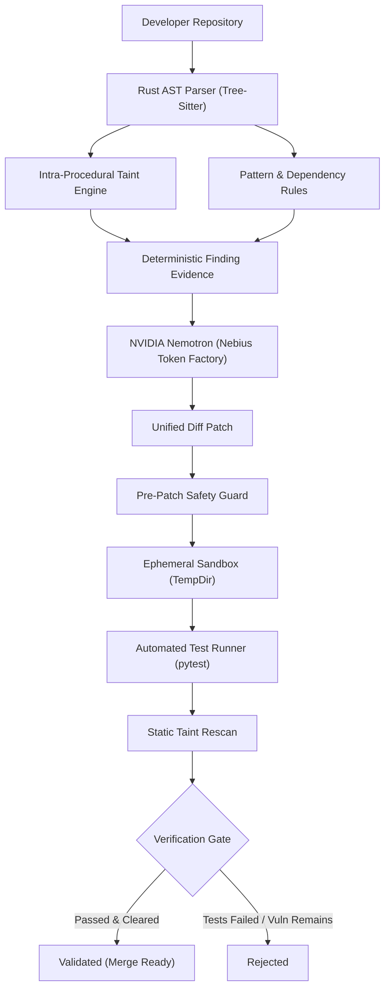

# SecScan AI: Architecture & Pipeline Design

## 1. Pipeline Overview

SecScan AI processes code through a four-stage verified pipeline:

## 2. Core Modules

### `secscan-core`
- **Tree-Sitter CST Parser:** Parses source code into high-fidelity syntax trees.
- **Variable Propagation Graph (VPG):** Tracks data flow across variable assignments, string interpolation, and function arguments without being misled by words inside string literals.
- **Deterministic Risk Engine:** Calculates an authoritative 0-100 score based on severity penalties.
- **SARIF Exporter:** Emits OASIS SARIF 2.1.0 with code flows and thread flows for GitHub Code Scanning integration.

### `secscan-nebius`
- **Inference Client:** Talks to Nebius Token Factory inference endpoints (`nvidia/llama-3.1-nemotron-70b-instruct`).
- **Prompt Isolation:** Encloses code snippets inside `<untrusted_evidence_context>` to prevent prompt injection.
- **Pre-Patch Safety Guard:** Scans generated code for dangerous primitives before sandboxing.

### `secscan-agent`
- **Workspace Cloning:** Copies the target repository into an isolated temporary folder.
- **Patch Applicator:** Applies unified diffs.
- **Sandbox Test Runner:** Executes the repository's test suite (`unittest` / `pytest`).
- **Rescan & Verification Policy:** Ensures the vulnerability was cleared and no regressions were introduced.

### `secscan-server`
- Axum web server exposing REST endpoints and serving the embedded single-page reactive dashboard at `http://localhost:3000`.
